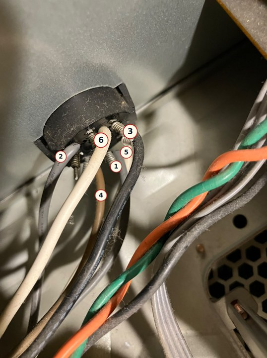
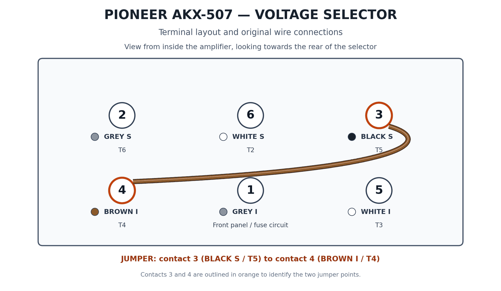
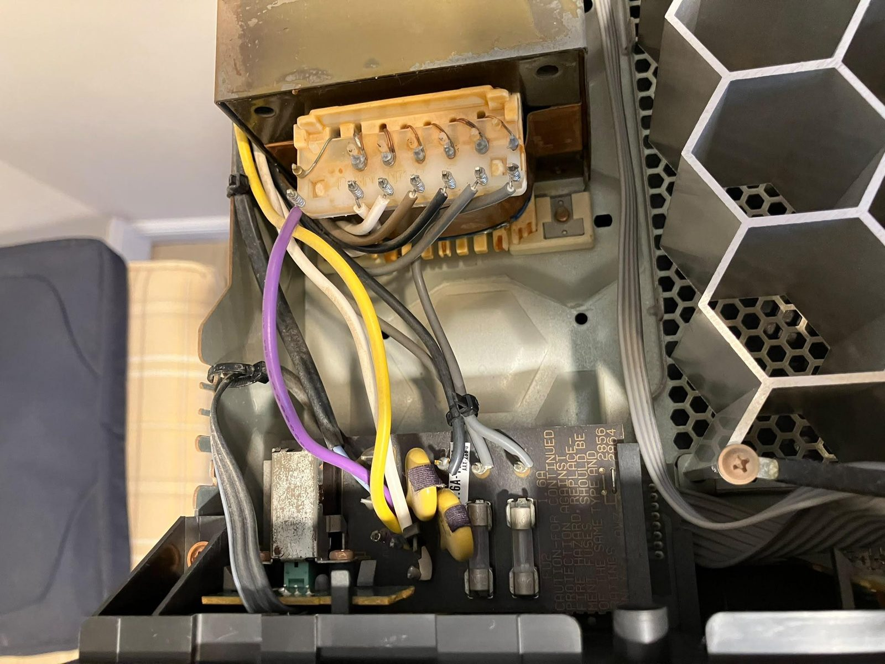
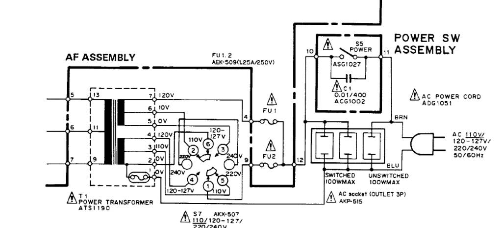
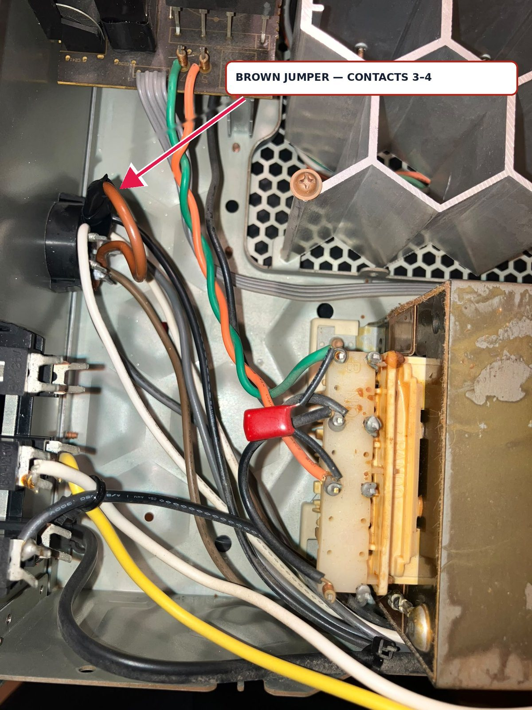
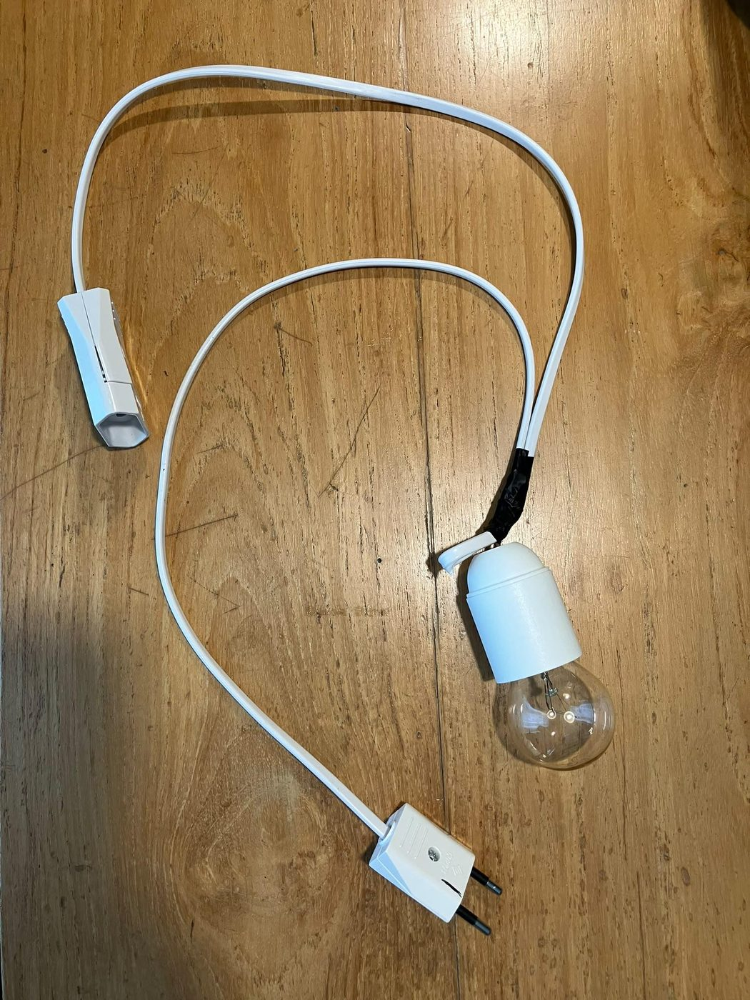

# Pioneer A-337/SD: selector de tensión AKX-507 roto — puente entre los contactos 3 y 4 (240 V)

Versión en español de mi hilo en AudioKarma (en inglés): <https://audiokarma.org/forums/threads/pioneer-a-337-sd-voltage-selector-akx-507-successful-3%E2%80%934-jumper-modification.1115567/>

Palabras clave: Pioneer A-337, A-337/SD, selector de tensión roto, AKX-507, transformador BANDO ATS1291, puente para 240 V.

> **Resumen.** Mi Pioneer A-337/SD (transformador BANDO ATS1291) había perdido el selector de tensión AKX-507. Un único puente entre los contactos 3 y 4 del selector dio la configuración de 240 V, y el amplificador funciona ahora con normalidad en una red de 230 V (237 V medidos en mi enchufe). Esto es el registro de lo que funcionó en **una** unidad, no una instrucción general de cableado: lee el aviso de seguridad del final.

Un amigo me regaló un Pioneer A-337/SD y me avisó de que, al girar el volumen, hacía un ruido de “radio vieja”. Pensaba limpiar el potenciómetro, pero durante el transporte se rompió el selector de tensión y la pieza rota se perdió.

El amplificador lleva un transformador BANDO ATS1291. Mi objetivo era configurarlo en la posición de 240 V, ya que la tensión nominal de la red en España y en gran parte de Europa es hoy de 230 V (en mi enchufe medí 237 V).

No encontré un esquema fiable de los terminales de este transformador. Por eso seguí el cableado y asigné mis propias etiquetas de referencia T1–T7 a los terminales relevantes. Son etiquetas de inspección, no números impresos en el transformador.

> Los hilos del selector los llamo Gris, Negro, Blanco y Marrón, con la letra **S** (grupo superior) o **I** (grupo inferior). En las imágenes aparecen con los nombres en inglés: GREY S = Gris S, BLACK S = Negro S, WHITE S = Blanco S, GREY I = Gris I, BROWN I = Marrón I, WHITE I = Blanco I.

## 1. Contactos y hilos del selector AKX-507

Numeré los seis contactos según los números rodeados del AKX-507 en un esquema de servicio de Pioneer de otro modelo (Fig. 1; ver también el apartado 3), que usé como referencia de trabajo durante la inspección. Las posiciones de abajo son las vistas **desde dentro del amplificador**, mirando hacia la parte trasera del selector (Figs. 2 y 3); vistas desde el panel trasero aparecen en espejo. Por eso, lo más seguro es identificar cada contacto por **adónde va su hilo** (el contacto 3 es el hilo que va a T5, el contacto 4 el que va a T4) y no por su posición.

- Fila superior, de izquierda a derecha: 2 – 6 – 3
- Fila inferior, de izquierda a derecha: 4 – 1 – 5

Los seis hilos eran:

- Contacto 1 — Gris I — va al circuito del frontal y los fusibles.
- Contacto 2 — Gris S — al terminal T6 del transformador.
- Contacto 3 — Negro S — a T5.
- Contacto 4 — Marrón I — a T4.
- Contacto 5 — Blanco I — a T3.
- Contacto 6 — Blanco S — a T2.

“S” e “I” eran mi abreviatura de los grupos superior e inferior de hilos del selector (Superior/Inferior en mis notas).

*Fig. 2. Los seis contactos del selector vistos desde dentro del amplificador, numerados como en el esquema de servicio.*

*Fig. 3. Disposición de los contactos del AKX-507 (vista desde dentro), conexiones originales de los hilos y puente 3–4.*

## 2. Cableado seguido desde la entrada de red hasta el transformador

Los hilos marrón y azul del cable de red entran por la parte trasera del amplificador y van al conjunto del frontal. Un par blanco/amarillo vuelve del frontal hacia las tomas de corriente traseras. Un hilo negro del frontal alimenta la toma marcada “UNSWITCHED 100W MAX”.

El hilo violeta del frontal va al terminal T1 del transformador. Es un terminal aparte, físicamente separado de los demás terminales relevantes (Fig. 4). Un hilo gris del frontal va a T7 a través de un fusible. Otro hilo gris, de la zona de fusibles, va al contacto 1 del selector.

La serigrafía de la placa junto a los dos fusibles incluye una marca “1.6A” y la advertencia habitual de sustituir los fusibles solo por otros del mismo tipo y valor.

El resto de hilos del selector se conectan al transformador como se indicó arriba.

*Fig. 4. Regleta de terminales del transformador BANDO ATS1291 y cableado cercano.*

## 3. Identificación de los terminales del transformador (T1–T7)

Llamé T1 al terminal separado del transformador que lleva el hilo violeta del frontal. Después etiqueté T2–T7 siguiendo sus hilos:

- T1 — Hilo violeta del frontal; terminal separado.
- T2 — Blanco S, contacto 6 del selector.
- T3 — Blanco I, contacto 5 del selector.
- T4 — Marrón I, contacto 4 del selector.
- T5 — Negro S, contacto 3 del selector.
- T6 — Gris S, contacto 2 del selector.
- T7 — Hilo gris del frontal, a través de un fusible.

Estas etiquetas T1–T7 las asigné yo durante la inspección. Curiosamente, coinciden con la numeración 1–7 del esquema selector/transformador de otro modelo de Pioneer con un transformador ATS1190 (Fig. 1). Es una referencia útil, pero no demuestra que el ATS1291 tenga la misma disposición interna de bobinados ni las mismas tomas de tensión.

*Fig. 1. Fragmento de un esquema de servicio de Pioneer de otro modelo con transformador ATS1190, que muestra el selector AKX-507 y el primario del transformador. Solo como referencia: no es el esquema del ATS1291.*

### Posibles etiquetas de tensión por comparación con el ATS1190

No encontré el esquema de conexiones del BANDO ATS1291 de este A-337/SD. Si el esquema del ATS1190 se usa solo como referencia comparativa, las etiquetas equivalentes serían:

| Mi etiqueta | Posible etiqueta de tensión por comparación con el ATS1190 |
|---|---|
| T1 | 0 V |
| T2 | 0 V |
| T3 | 110 V |
| T4 | 120 V |
| T5 | 0 V |
| T6 | 10 V |
| T7 | 120 V |

**Importante:** estas etiquetas de tensión son solo ilustrativas. No las he verificado para el ATS1291. Que los números de referencia coincidan no demuestra que los dos transformadores tengan conexiones eléctricas idénticas. No deben usarse como especificación de cableado.

## 4. Medidas de resistencia

Usé un multímetro Pro’sKit MT-120 en la escala de 200 ohmios. La resistencia de las puntas del multímetro en cortocircuito era de unos 0,9–1,0 ohmios, así que las lecturas son aproximadas; el medidor tenía poca precisión a estas resistencias bajas y algunas lecturas variaban antes de estabilizarse. He omitido dos lecturas que parecían incoherentes entre sí y que no pude repetir. “OL” = fuera de rango (circuito abierto).

Medidas en los hilos del selector:

| Medida | Lectura |
|---|---|
| Gris S–Negro S | 1,1–1,7 Ω |
| Blanco S–Gris S | OL |
| Blanco S–Negro S | OL |
| Blanco I–Gris I | OL |
| Marrón I–Gris I | OL |
| Gris S–Blanco I | OL |
| Gris S–Marrón I | OL |
| Gris S–Gris I | 5,5–5,8 Ω |
| Blanco S–Blanco I | 5,0 Ω |
| Blanco S–Marrón I | 5,2 Ω |
| Blanco S–Gris I | OL |
| Negro S–Blanco I | OL |
| Negro S–Marrón I | OL |
| Negro S–Gris I | 5,9–6,0 Ω |

Medidas directamente en los terminales del transformador:

| Medida | Lectura |
|---|---|
| T1–T2 | 0,5 Ω |
| T1–T3 | 4,8 Ω |
| T1–T4 | 5,2 Ω |
| T1–T5 | OL |
| T1–T6 | OL |
| T1–T7 | OL |
| T7–T6 | 5,3 Ω |
| T7–T5 | 5,6 Ω |
| T7–T4 | OL |
| T2–T3 | 5,1 Ω |
| T2–T4 | 5,4 Ω |
| T5–T6 | 1,1 Ω |
| T2–T5 | OL |
| T3–T5 | OL |

Estas lecturas me ayudaron a seguir los grupos de terminales conectados y a entender el cableado: T1–T4 forman un grupo y T5–T7 otro, sin continuidad entre ambos. Esto es coherente con un primario formado por dos bobinados separados, como en el esquema del ATS1190, pero las medidas de resistencia por sí solas no establecen las tomas de tensión nominales del transformador ni la polaridad de los bobinados.

## 5. La modificación: un puente entre los contactos 3 y 4

La única modificación que hice en el cableado del selector y el transformador fue **un único puente, colocado en el zócalo del selector**, que une:

**contacto 3 del AKX-507 (NEGRO S) con el contacto 4 (MARRÓN I).**

Es decir, coloqué un cable marrón corto entre los dos pines de contacto del zócalo del selector; no cambié nada en los terminales del transformador. Eléctricamente, esto une los hilos que van a T5 y T4 (Figs. 3 y 5).

Una página de JustAnswer sobre este amplificador (<https://www.justanswer.com/car-electronics/gjarq-pioneer-stereo-amp-a-337-sd-switchable-voltage.html>) también menciona un puente entre los terminales 3 y 4 para 240 V, y enumera otros cambios de cableado. No hice ninguno de esos otros cambios.

Con el puente instalado medí unos 10,7 ohmios entre T2 y T7. Con el interruptor de encendido en ON, la resistencia medida entre las clavijas del enchufe de red era de unos 10,8 ohmios; con el interruptor apagado, circuito abierto (OL). Fueron solo observaciones de resistencia, no pruebas que demuestren que el cableado de red fuera seguro.

Cuando el amplificador ya funcionaba, pegué la pieza de plástico rota del selector sobre la abertura a modo de tapa ciega, para cubrir los contactos restantes de la parte trasera (por seguridad y por estética).

*Fig. 5. El puente marrón entre los contactos 3 y 4 del zócalo del selector (flecha añadida a la foto).*

## 6. Primer encendido

Tras instalar el puente conecté el amplificador directamente a la red. En retrospectiva fue el orden equivocado: **el primer encendido debe hacerse a través de un limitador de bombilla en serie** (apartado 7). Al principio pensé que seguía sin encender.

El LED rojo de POWER luce muy tenue y, con la luz de la habitación, simplemente no lo vi. Además, apagué el amplificador demasiado pronto para oír el clic del relé, que ocurre unos segundos después de encender.

Fue una falsa impresión: el amplificador sí se había encendido.

## 7. El limitador de bombilla en serie y el segundo encendido

Como creía que el amplificador no había encendido, repasé el cableado e intenté con empeño encontrar el esquema del transformador ATS1291. No lo encontré y no avanzaba.

Antes de hacer la conexión directa definitiva, decidí construir un alargador sencillo (Fig. 6) con una bombilla incandescente convencional de 40 W conectada en serie con el conductor de fase, que identifiqué con un buscapolos. Debe ser una bombilla incandescente antigua, no una LED. Un cable así es solo una herramienta de taller: el portalámparas y el empalme deben estar completamente aislados y fijos, y no hay que tocar nada mientras esté enchufado.

Con el amplificador encendido (interruptor en ON), lo enchufé. La bombilla dio un destello breve y después quedó muy tenue. Si la bombilla se hubiera quedado a pleno brillo, habría indicado un cortocircuito o un fallo de cableado, y habría que haber desenchufado el amplificador de inmediato.

Esto me animó a volver a conectar el amplificador directamente a la red, esta vez sin el limitador. Esperé unos segundos hasta oír el clic del relé y entonces conecté los auriculares. Los sistemas de altavoces A y B estaban desconectados.

El amplificador funcionaba, aunque seguía con los problemas de sonido descritos a continuación.

*Fig. 6. Mi limitador de bombilla en serie improvisado. El empalme está solo con cinta en este prototipo; hay que usar conexiones bien cerradas.*

## 8. El ruido original del control de volumen

El amplificador seguía con la avería que mencionó mi amigo: fuertes crujidos al girar el volumen, con pérdida ocasional del canal derecho.

Traté el potenciómetro con limpiacontactos, en mi caso DUE-CI Electronic R-11. El ruido y el problema del canal derecho desaparecieron, y el amplificador funciona ahora perfectamente, a pleno rendimiento. El limpiacontactos solo debe usarse con el amplificador desenchufado y hay que dejar que se evapore antes de encenderlo.

## Nota sobre otros modelos de Pioneer

El selector de tensión AKX-507 y primarios de transformador con varias tomas similares se usan en otros amplificadores Pioneer. Según los manuales de servicio que consulté, entre ellos están los de la tabla de abajo. Sus esquemas me sirvieron de guía general para seguir el circuito. El A-339/SD es especialmente relevante, porque su manual de servicio dice que comparte gran parte de su construcción con el A-337/HE.

| Modelo | Transformador de alimentación |
|---|---|
| A-339/SD | ATS1344 |
| A-449/SD | ATS1289 |
| A-229/SD | ATS1190 |
| A-119/SD | ATS1192 |
| A-307R/SDXJ | ATS7189 |
| A-337/SD (el mío) | BANDO ATS1291 |

Como cada modelo usa un transformador distinto, el esquema de otro modelo es solo una referencia, no unas instrucciones de cableado. Los números de terminal y las etiquetas de tensión de esos transformadores no deben darse por válidos para el ATS1291. Las etiquetas de tensión del apartado 3 proceden del esquema del ATS1190: parecen plausibles, pero no las he verificado en mi transformador.

Si tienes un amplificador parecido con el selector roto o perdido, te sugiero lo siguiente. Primero, identifica cada contacto del selector siguiendo su hilo hasta el terminal del transformador, en lugar de fiarte de la posición o el color. Segundo, con el equipo desenchufado, mide las resistencias para saber qué terminales pertenecen al mismo bobinado y compara ese patrón con el esquema de tu modelo. Tercero, deduce cualquier puente a partir de tus propias medidas y del esquema del selector de tu modelo, y usa un limitador de bombilla en serie en el primer encendido. El puente 3–4 descrito aquí funcionó en mi unidad y puede no ser el correcto para la tuya.

## Aviso de seguridad importante

Este texto es el registro de lo que funcionó en mi amplificador concreto. No es una instrucción general de cableado, ni demuestra que el mismo puente sea correcto para todos los modelos de Pioneer. El amplificador funciona con tensión de red, que puede ser mortal. Cualquier inspección o modificación debe hacerse con el equipo desenchufado, y todo el cableado final debe quedar bien aislado y sujeto. No te fíes solo de medidas de baja resistencia ni de una prueba con bombilla en serie para determinar si algo es seguro. La abertura que deja un selector ausente también debe taparse, porque los contactos de detrás pueden tener tensiones derivadas de la red.

Comparto esta experiencia con la esperanza de que ayude a otros propietarios del A-337/SD cuyo selector de tensión AKX-507 se haya roto o perdido, algo que parece no ser raro.
